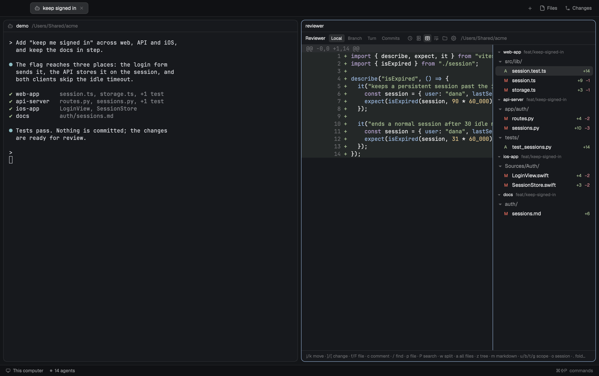

# Reviewer

Review everything your agents changed, across every repo they touched, in one pane beside the
terminals. A feature that spans a web app, an API, a mobile app and the docs shows as one file list
grouped by repo, each repo with its branch, next to a diff with syntax colors. You choose what to
diff (uncommitted changes, the whole branch against its base, the agent's last turn, or chosen
commits), comment on lines, then copy the review or place it in the agent's input without
submitting.

## What you see

The pane is on the theme's `background`, 13px UI text. From top to bottom: a control row, the
changes, and a footer. The changes are stacked (file list above the diff) by default; side by
side, the diff is on the left and the file list on the right.

- **Control row, 32px, `border` below.** "Reviewer" in 12px semibold. Then the scope tabs
  "Local", "Branch", "Turn" and "Commits" in 11px, each 20px tall; the current one has a
  `selected` background and `foreground` text, the others `dim`. After an 8px gap, 14px icon
  toggles: This session (clock), All files, Side by side, Wrap; then Folders and Settings (gear).
  A toggle that is on has a `selected` background. Each control has a tooltip naming it and its
  key ("Side by side (l)"). When comments are unsent, a pill reads "N unsent" (`accent`
  background, `accent_foreground` text, 11px, 4px radius). Last, the base folder's path in `dim`,
  truncated. The row is left out when the layout's pane header draws these controls itself.
- **File list.** Stacked: as tall as its rows (24px each, plus 12px), between 44px and 240px,
  scrolling, with a bottom border. Side by side: 35% of the pane wide, at most 320px, full height,
  with a left border. The border is `accent` while the list has the keyboard, `border` otherwise.
  - One group per watched repo with changes (in the Branch scope, every repo). Its 24px heading,
    11px: a `▾` (or `▸` and an "N files" count in `dim` when collapsed), the repo's folder name in
    semibold (the full path as a tooltip), then the branch it is on in `dim`. In Branch, the base
    at the right in `accent` ("vs main"); in Commits, the picked commits ("commit a1b2c3d").
    Clicking the base or commits opens that picker; clicking the name collapses the repo.
  - Under the heading, a `dim` 11px note when needed: "No changes since main", a picked base
    that no longer resolves, or why a repo has no range.
  - Files show as a folder tree by default: folders first, then files, by name, 14px indent per
    level. A folder row is `▾` and "src/lib/" in `muted`; a folder holding only one folder shares
    its row ("src/app/"); a closed folder shows `▸` and its file count. In the flat list, each row
    is the folder part of the path in `dim`, then the file name.
  - A file row, 24px, 6px radius: the status letter in 11px (A in `ansi2`, M in `blocked`, D and U
    in `ansi1`), the name, then `+N` in `ansi2` and `−N` in `ansi1`, both 11px. The selected file
    has a `selected` background; rows take `hover` under the pointer.
  - Last, under 11px semibold headings: "No longer changed, with comments" (files that stopped
    changing but hold comments, status `·` in `dim`), and in the Turn scope "Earlier turns, with
    comments".
  - With This session on, a note at the top: "This session only: files the agent's turns changed
    since 14:02".
- **Diff, fills the rest.** In the terminal's font and weight, at the terminal's font size (or up
  to two points from it, in the settings), each row as tall as a terminal row; scrolls both ways.
  Hunk headers on `raised` in `dim`. Each line: a 3px bar (`accent` when the line is commented),
  the old and new line numbers right-aligned in `dim` (34px columns at 12px, scaled with the
  size), a `+` in `ansi2` or `−` in `ansi1`, then the text colored by syntax. Added lines have an
  `ansi2` tint (hex alpha `18`), removed lines an `ansi1` tint; the cursor line is `selected` and
  a selection is `selection`. Find matches are marked in `accent` at alpha `55`.
  - Under a comment's last line, its text on a `raised` row indented 48px, after a 3px `accent`
    bar. A stale comment is `dim` and says "stale: lines changed" in `blocked`, 11px.
  - Split ("Old beside new"): each side takes half the width, with one line-number column; a side
    with no line opposite is `raised`.
  - All files: every listed file's diff in one list, each under a heading row on `raised` with a
    top border: the status letter, "web-app/src/lib/session.ts" in semibold (the repo name only
    when several repos are watched), the counts, and in `dim` why the diff is short.
  - Wrap on: long lines break at the pane's edge and the row grows to fit.
  - Rendered Markdown: a note "Rendered as it reads after these changes · m shows the diff", then
    the file rendered with 16px side padding.
  - A binary or unreadable file shows a one-line notice instead of rows.
- **Footer, 28px, `border` above.** A key hint in `dim` 11px, replaced by the latest notice in
  `foreground` ("Copied 2 comments") or an error in `blocked`. It becomes a box in these cases:
  - Commenting: an 11px `muted` label ("Comment on src/lib/session.ts") over a 30px input with a
    6px radius and an `accent` border.
  - Finding: a label with the match count, over the same input.
  - Sending to one of several agents: "Send to which agent?", then one 26px row each: its number,
    app, title in `dim`, and status (`blocked` in `blocked`).
  - Picking: a title saying what Enter, Shift+Enter, Tab and Esc do, the filter input, and up to
    ten 24px rows. Branches show the name, then "default", "picked" and age in `dim`; commits the
    short id (`accent` when marked as a run's end), subject, and repo and age in `dim`; files the
    status and path; code search the path and line in `dim`, the mark, and the line; folders the
    name, with a `git` or `recent` tag in `dim`.

The folders view replaces the list and diff: one 28px row per watched folder with its path (and
"in <repo root>" as a tooltip when it sits inside a repo), a note in 11px (the branch in `dim`, or
"missing", "not a git repository", or "not watched: the limit is 10" in `blocked`), then "base"
and a Change button for the base folder, or a Remove button; last, an "Add folder" button. Buttons
are 24px tall with a 1px `border` and 6px radius, 11px text. When no watched folder is a repo, the
changes view shows "No git repository here. Change the folder, or add one that holds a
repository." with "Change folder" and "Add folder" buttons.

Settings open as a 540×640 popup on `popover`: "Reviewer settings" in 15px semibold with a ×, then
three groups headed in 11px semibold `dim` capitals ("Every pane", "New panes", "Limits"). Each
setting is a title, an 11px `muted` description, and segment buttons; the chosen one is on
`raised` with a border.

## How it behaves

- Agent status drives two things. A turn starts when an agent in the reviewer's tab moves to
  `working` while no turn is open, and ends when every agent there is `idle` or `done`; `blocked`
  keeps it open. When sending, a `blocked` agent is refused with "Not sent: the agent is waiting
  on a question"; `working`, `done` and `idle` agents take the paste.
- `mod.open:reviewer` (bound to a key) opens the pane to the right of the focused pane, bound to
  that pane's folder (its base folder), and closes it when the tab already has one. The pane does
  not follow focus afterwards. `.` or Change picks a new base folder, kept for that tab across
  restarts; opening a reviewer with the key starts from the focused pane's folder again.
- Repos come from the base folder plus folders added in the folders view, up to 10; an 11th is
  refused with a notice. A folder inside a repo already watched adds nothing new. The added
  folders are saved per base folder and come back whenever a reviewer opens there.
- Change and Add folder open the system's folder picker, or, with Folder picker set to Typed, a
  box in the footer: open terminals' folders (this tab's first) and recent picks, filtered by the
  words typed; a path starting with `/` or `~` lists that folder's subfolders. Tab fills in the
  selected folder, Enter picks, Esc cancels.
- Scopes, every pane starting on Local (or the Starting scope setting):
  - Local (`u`): staged, unstaged and untracked changes; ignored files are not listed.
  - Branch (`b`): each repo from its merge base with its own base to the working tree. The base is
    the local branch the reflog says the current branch was made from, then the local copy of
    `origin/HEAD`'s branch, `init.defaultBranch`, `main`, `master`. `B` or the base name picks
    another branch or any revision, kept per repo across restarts; "Forget the pick" drops it.
  - Turn (`t`): what the agent's last turn changed in every watched repo, commits made during the
    turn included, against a snapshot taken when the turn started. A turn that changes nothing
    leaves the previous one shown. If a file changed just as the turn started, the turn shows
    nothing and says why.
  - Commits (`g`): `G` lists recent commits from every watched repo; Enter picks one, Shift+Enter
    marks one end of a run and Enter the other. A run is ordered by ancestry; two commits on
    separate lines of history are refused.
  - This session (`o`, the clock): narrows any scope to the files the agent's turns changed since
    the pane opened.
- The list and the open diff refresh when anything under a watched repo changes on disk, and on a
  timer (10 seconds by default, set in the settings). Colors fill in after the text: rows on
  screen first, then the rest in batches.
- Keys while the pane has the keyboard: `j`/`k` move, `]`/`[` jump between change blocks, `f`/`F`
  change files, `Tab` switches between list and diff, `v` starts and ends a selection, `c`
  comments, `e`/`d` edit and delete the comment at the cursor, `y` copies the review, `s` sends
  it, `/` finds in the diff and `n`/`N` step through matches, `p` goes to a file by name, `P`
  searches the changed lines of every listed file, `l` switches the layout, `w` the split diff,
  `a` all files, `z` tree or flat, `m` rendered Markdown, `,` opens the settings, `Esc` cancels
  the nearest open thing (picker, selection, notice) before it clears the find text, `Enter`
  saves a box, `1`–`9` pick an agent. Each is also a `reviewer.<action>` command.
- Layout, diff, all files, file list, wrap and text size are one choice for every reviewer, kept
  across restarts, and open panes follow a change at once.
- Clicking a repo name or folder collapses or expands it, and `f`/`F` skip what it hides.
  Clicking a file opens its diff; clicking a diff line moves the cursor there (in a split line,
  to its new side).
- A comment keeps the scope it was made in (Branch with that repo's base, Commits with that repo
  and run, Turn with that turn) and shows only there; the review names it. A comment whose lines
  change on disk is kept and marked stale. Comments and selection are refused while Markdown shows
  rendered.
- Send copies the review to the clipboard, focuses the agent's pane, and pastes. It never presses
  Enter. With one agent in the tab it goes straight there; with several, the footer asks which.
  Comments clear after a send and stay after a copy.

## Built from

- One pane mod, `mods/reviewer/`, opened with `pane.split {direction: "right", pane, mod:
  "reviewer", props: {base, tab}}`. The same mod, opened by `mod.open` as a 1×1 popup with no
  frame, is the launcher: it closes the tab's reviewer panes or opens one, then calls
  `closeOverlay`. Opened by `openOverlay` with `props: {screen: "settings"}` as a 540×640 dialog,
  it is the settings.
- `main.js` is the view. Pure modules hold the logic, testable under `node --test`: `scope.js`
  (the one function that decides which repos and files show, This session included), `git.js`
  (read-only git commands and diff parsing), `revs.js` (bases, merge bases, branches, commits),
  `turns.js` (turn tracking and snapshots), `syntax.js` (highlight.js in batches), `review.js`
  (comment anchors, stale detection, the review text), `nav.js` (cursor movement), `tree.js`
  (tree and flat rows), `split.js` (old beside new), `all.js` (all files in one diff), `wrap.js`,
  `find.js` (find and code search), `folders.js` (the typed picker), `settings.js` (choices and
  defaults), and `head.js` (the controls, shared with a pane header).
- `herdr` functions: `exec`, `readTextFile`, `watchFolder` (one loop per repo), `pickFolder`,
  `shared`/`setShared`, `agents`, `panes`, `focused`, `spaces`, `layout`, `home`, `props`,
  `nextCommand`, `run` (`pane.split`, `pane.close`, `pane.focus`, `terminal.paste`),
  `openOverlay`, `closeOverlay`, `theme`, `settings` (the terminal's font, size, weight and line
  height).
- Shared keys: `reviewer.watch` (base folder → added folders), `reviewer.base-folder` (tab →
  base folder picked in the pane, pruned to live tabs), `reviewer.recent-folders` (the last 10
  picks), `reviewer.bases` (repo root → picked base), `reviewer.layout`, `reviewer.diff`,
  `reviewer.files`, `reviewer.wrap`, and `reviewer.settings` (the other settings, only those
  changed from the default). It writes its title, folder and controls to `pane-heads` under its
  pane id, and leaves out its control row when the layout's pane header is registered in
  `pane-heads-headers` as drawing `actions`.
- gpui-kit: `v_virtual_list` for the diff (clicks through `on_item_click`), `InputState`/`Input`
  for the boxes (the filter's `submit` event carries `shift`), `TextView.markdown`, `Scrollbar`,
  `VirtualListScrollHandle`, `cx.write_to_clipboard`.
- Programs: `git`, always with `--no-optional-locks -c core.fsmonitor=false -c
  diff.autoRefreshIndex=false`. For turn snapshots, `git add -A` and `git write-tree` with
  `GIT_INDEX_FILE` and `GIT_OBJECT_DIRECTORY` pointed at a per-pane folder in `$TMPDIR` (set through
  `env`), plus
  `sh`, `cp`, `find`, `mkdir` and `rm` on that folder only. The typed picker runs `find` on the
  folder typed.
- Art: seven 14px SVG icons in `icons/` (session, files, side, wrap, folder, gear, close). Syntax
  colors map highlight.js scopes to theme colors: comment `dim`, keyword `ansi5`, string `ansi2`,
  number `ansi3`, title and function `ansi4`, type and built-in `ansi6`. highlight.js 11.12.0
  (common languages) is vendored under `vendor/` with its license.

## Watch out

- One script slice is cut off after 500 ms, silently: the task stops and its `finally` never runs.
  Anything long yields with `await cx.sleep(0)`; highlighting runs in batches sized by characters
  (minified code costs about 7 ms per KB), lines over 500 characters stay uncolored, and the split
  view colors each span of rows on screen, not everything between the first and last.
- A mod's host calls fail once 1024 are outstanding: read files in small waves, not all at once.
- Handlers such as `on_click` throw inside a `v_virtual_list` row renderer; use `on_item_click`.
- Button handlers must use the click's own `cx`; `render`'s `cx` is stale once render returns.
- A press bubbling to the root takes the keyboard back, so the boxes and the rendered Markdown
  stop `mouse_down`, or typing, Enter and copying break.
- `h_flex` centers its children, so a row holding a scroll area needs `items_stretch()` or the
  area gets no height.
- `readTextFile` rejects on bytes that are not UTF-8 and gives null past 1 MiB; a JS string's
  length is not its size in bytes, so check blobs with `git cat-file -s`.
- A regex such as `/[^\t]*\t/g` is quadratic on long lines without tabs; split on tabs instead.
- `<mod>.<command>` reaches only copies that are shown, so the toggle goes through `mod.open`; a
  command run from `init` in a pane the launcher opened never settles, so start turn work from a
  timer.
- Read-only git needs those three flags, or `git status` refreshes the index and the folder watch
  sees its own writes. Snapshots also need `core.hooksPath=/dev/null` and no clean filters, must
  copy the index with `cp -p`, and must skip repos with a split index, or they write under `.git`.
- The empty tree's id differs between SHA-1 and SHA-256 repos; ask git for it.
- Herdr sends no turn event: sample the tab's agents (every 250 ms here) for the move into work.
- Limits: 10 watched folders; by default 1,000 files per repo, 1,500 diff lines per file, lines
  cut at 4,000 characters; all files stops at 200 files or 20,000 rows; code search reads up to
  100,000 rows and shows 200 matches. Comments live only as long as the pane. Local machine only.

## Done when

- The toggle key opens a reviewer beside a terminal in a repo, showing that folder, and closes it.
- With two added repos, each repo with changes gets its own group, headed by its name and branch;
  a subfolder of a watched repo adds nothing new; an 11th folder is refused.
- A staged, an unstaged, and an untracked file are listed with status and line counts in a folder
  tree; an ignored file is not; `z` flattens the list.
- A `.ts` diff shows old and new line numbers, and a keyword, a string, and a comment in three
  different colors; a binary file shows a notice.
- Saving a file in a watched repo updates the list and the open diff within 3 seconds.
- `git status`, the index, refs and every file under `.git` are unchanged after a session that
  used every scope.
- `b` shows "vs main" on a branch made from `main`, and lists its commits' files with the
  uncommitted ones; `B` and another branch changes it, and a restart keeps the pick.
- An agent turn that edits one file shows only that file under `t`, even with other uncommitted
  changes.
- `c`, typing, and Enter shows the comment under its line and "1 unsent"; `v`, three moves, `v`,
  `c` covers four lines; editing a commented line on disk marks the comment stale.
- `y` puts the review on the clipboard, repos in path order; `s` with one idle agent fills its
  input without submitting, focuses it, and clears the comments.
- `l` puts the file list right of the diff, `w` shows old beside new, `a` shows every file in one
  list; each choice holds after a restart.
- A 1,500-line TypeScript diff shows text at once and is fully colored within a second, with no
  interruption in the app's log.
