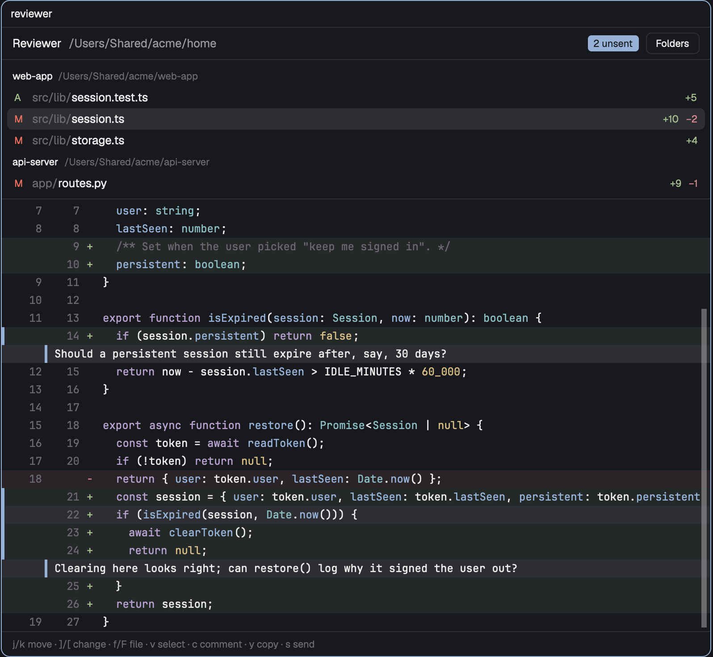

# Reviewer

A pane beside your terminals that shows the changes in a folder, and in other folders you add, as
a unified diff with syntax colors: uncommitted changes, everything on the branch, or chosen
commits. You comment on lines and ranges, then copy
the comments or place them in an agent's input without submitting.

## What you see

The pane is on the theme's `background`, 13px UI text, in five parts. By default they are
stacked from top to bottom; side by side, the file list moves to the right of the diff:

- **Header, 36px.** "Reviewer" in semibold, then the base folder's path in `muted`, truncated. When
  comments are unsent, a pill reads "N unsent" (`accent` background, `accent_foreground` text,
  11px). At the right, a bordered 24px button: "Folders", or "Changes" while the folders view is
  open.
- **Toolbar, 32px, changes view only.** Scope buttons "Uncommitted", "Branch", and "Commits"; the
  current one has a `selected` background. At the right, "Side by side" or "Stacked".
- **File list, up to 240px tall, scrolls; side by side, 35% of the pane wide (at most 320px) and full height.** One group per repo with changes (in the branch
  scope, every repo): a 24px heading with the repo's folder name in semibold and its full path in
  `dim`, both 11px, after a `▾` (or `▸` and an "N files" count when collapsed: clicking the
  chevron and name hides the repo's file rows, and file navigation skips them), then, in `accent`,
  the base ("vs main") or the picked commits ("commit
  a1b2c3d"); clicking it opens that picker. A note under the heading in `dim` says when a repo has
  nothing in the scope, when its picked base is gone, or why it has no range. Under it, one 24px row
  per changed file: a status letter (A in `ansi2`, M in `blocked`, D and U in `ansi1`), the folder
  part of the path in `dim`, the file name, then `+N` in `ansi2` and `−N` in `ansi1`. The
  selected file has a `selected` background; rows take `hover` under the pointer. Files that
  stopped changing but hold comments sit last, under "No longer changed, with comments", with a
  `·` status in `dim`. The list's bottom border (left border side by side) is `accent` while it
  has the keyboard, `border` otherwise.
- **Diff, fills the rest.** In the settings' mono font at 12px, 20px rows, scrolling both ways.
  Hunk headers on `raised` in `dim`. Each line: a 3px bar (`accent` when the line is commented),
  the old and new line numbers right-aligned in 34px columns in `dim`, a `+` or `−` mark, then the
  text colored by syntax. Added lines have an `ansi2` tint (hex alpha `18`), removed lines an
  `ansi1` tint; the cursor line is `selected` and a selection is `selection`. Under a comment's
  last line, its text sits on `raised` rows indented 48px with an `accent` bar; a stale comment is
  `dim` and says "stale: lines changed" in `blocked`. A binary or unreadable file shows a one-line
  notice instead.
- **Footer, 28px.** A key hint in `dim` 11px, replaced by the latest notice ("Copied 2
  comments", "Not sent: no agent in this tab") or an error in `blocked`. While commenting, it
  becomes a label ("Comment on src/a.ts") over a 30px input with an `accent` border. While
  choosing an agent, it lists each one numbered, with its app, title, and status. While picking a
  base or commits, it shows a title, a 30px filter input with an `accent` border, and up to ten
  24px rows: branches with "default", "picked", and age in `dim`, plus a "Use revision" row for
  typed text; or commits with the short id (`accent` when marked as a run's end), subject, and
  repo and age in `dim`.

The folders view replaces the list and diff: one 28px row per watched folder with its path, a
note ("not a git repository", "missing", "in /path/of/repo"), and a Remove button, or "base" for
the base folder; then an "Add folder" button. When no watched folder is a repo, the changes view
shows "No git repository here. Add a folder that holds one." and an "Add folder" button.

## How it behaves

- Agent status matters only when sending: `blocked` refuses with "Not sent: the agent is waiting
  on a question"; `working`, `done`, and `idle` agents take the paste.
- `mod.open:reviewer` (bound to a key) opens the pane to the right of the focused pane, bound to
  that pane's folder, and closes it when the tab already has one. The binding does not follow
  focus afterwards.
- The list and the open diff refresh when anything under a watched repo changes on disk, and on a
  10-second timer. Colors fill in after the text: visible rows first, then the rest in batches.
- Keys while the pane has the keyboard: `j`/`k` move, `]`/`[` jump between change blocks, `f`/`F`
  change files, `Tab` switches between list and diff, `v` starts and ends a selection, `c`
  comments, `e`/`d` edit and delete the comment at the cursor, `y` copies the review, `s` sends
  it, `l` switches the layout, `Esc` clears the selection or cancels the box, `Enter` saves the box, `1`–`9` pick an agent.
  Each is also a `reviewer.<action>` command.
- The layout is one setting for every reviewer and survives restarts.
- Scope (`u`/`b`/`g`) starts at Uncommitted in every pane. Branch diffs each repo from its merge
  base with the base to the working tree, untracked files included. Commits diffs from the
  oldest picked commit's parent (or the empty tree) to the newest. `B` and `G` open the pickers;
  in them, typing filters, `↑`/`↓` move, Enter picks, Shift+Enter marks a run's end, Esc closes.
- Base picks survive restarts, per repo. A comment keeps the scope it was made in (Branch with
  that repo's base, Commits with that repo and run) and shows only there; the review names it.
  Switching scope clears the list until the new scope loads. A run's ends are ordered by
  ancestry; two commits on separate lines of history are refused.
- Clicking a file opens its diff; clicking a diff line moves the cursor there.
- Send copies the review to the clipboard, focuses the agent's pane, and pastes. It never presses
  Enter. With one agent in the tab it goes straight there; with several, the footer asks which.
  Comments clear after a send and stay after a copy.

## Built from

- One pane mod, `mods/reviewer/`, opened with `pane.split {direction: "right", pane, mod:
  "reviewer", props: {base, tab}}`. The same mod, opened by `mod.open` as a 1×1 popup with no
  frame, acts as the launcher: it closes the tab's reviewer panes or opens one, then calls
  `closeOverlay`.
- `main.js` is the view. Pure modules hold the logic, testable under `node --test`:
  `scope.js` (the one function that decides which repos and files show), `git.js` (read-only git
  commands and diff parsing), `revs.js` (bases, merge bases, branches, and commits), `syntax.js` (highlight.js in batches), `review.js` (comment anchors,
  stale detection, the review text), and `nav.js` (cursor movement).
- `herdr` functions: `exec` (git), `readTextFile`, `watchFolder` (one loop per repo),
  `pickFolder`, `shared`/`setShared` (key `reviewer.watch`: base folder → added folders; key
  `reviewer.layout`: `"stacked"` or `"side"`; key `reviewer.bases`: repo root → picked base),
  `agents`, `panes`, `focused`, `props`, `nextCommand`, `run` (`pane.split`, `pane.close`,
  `pane.focus`, `terminal.paste`), `closeOverlay`, `theme`, `settings`.
- gpui-kit: `v_virtual_list` for the diff (clicks through `on_item_click`), `InputState`/`Input`
  for the comment box and the picker filter (its `submit` event carries `shift`), `Scrollbar`, `VirtualListScrollHandle`, `cx.write_to_clipboard`.
- Programs: `git` only, always with `--no-optional-locks -c core.fsmonitor=false -c
  diff.autoRefreshIndex=false`.
- Art: none. Syntax colors map highlight.js scopes to theme colors: comment `dim`, keyword
  `ansi5`, string `ansi2`, number `ansi3`, title and function `ansi4`, type and built-in `ansi6`.
  highlight.js 11.12.0 (common languages) is vendored under `vendor/` with its license.

## Watch out

- One script slice is cut off after 500 ms, silently: the task stops and its `finally` never runs.
  Anything long yields with `await cx.sleep(0)`; highlighting runs in batches sized by characters
  (minified code costs about 7 ms per KB), and lines over 500 characters stay uncolored.
- A mod's host calls fail once 1024 are outstanding: read files in small waves, not all at once.
- Handlers such as `on_click` throw inside a `v_virtual_list` row renderer; use `on_item_click`.
- Button handlers must use the click's own `cx`; `render`'s `cx` is stale once render returns.
- `readTextFile` rejects on bytes that are not UTF-8 and gives null past 1 MiB.
- A regex such as `/[^\t]*\t/g` is quadratic on long lines without tabs; split on tabs instead.
- `<mod>.<command>` reaches only copies that are shown, so the toggle goes through `mod.open`.
- Read-only git needs those three flags, or `git status` refreshes the index and the folder watch
  sees its own writes.
- Limits: 10 watched folders, 1,000 files per repo, 1,500 diff rows per file. Comments live only
  as long as the pane. Local machine only.

## Done when

- The toggle key opens a reviewer beside a terminal in a repo, showing that folder, and closes it.
- A staged, an unstaged, and an untracked file are listed with status and line counts; an ignored
  file is not.
- A `.ts` diff shows old and new line numbers, and a keyword, a string, and a comment in three
  different colors; a binary file shows a notice.
- Saving a file in a watched repo updates the list and the open diff within 3 seconds.
- `git status`, the index, and refs are unchanged after a session.
- A home folder that is not a repo shows the add-folder prompt; added repos each get a group, and
  a subfolder of a watched repo adds nothing new.
- `c`, typing, and Enter shows the comment under its line and "1 unsent"; `v`, three moves, `v`,
  `c` covers four lines; editing a commented line on disk marks the comment stale.
- `y` puts the review on the clipboard, repos in path order; `s` with one idle agent fills its
  input without submitting, focuses it, and clears the comments.
- `l` puts the file list right of the diff, and again back on top; the choice holds after a
  restart.
- A 1,500-line TypeScript diff shows text at once and is fully colored within a second, with no
  interruption in the app's log.
